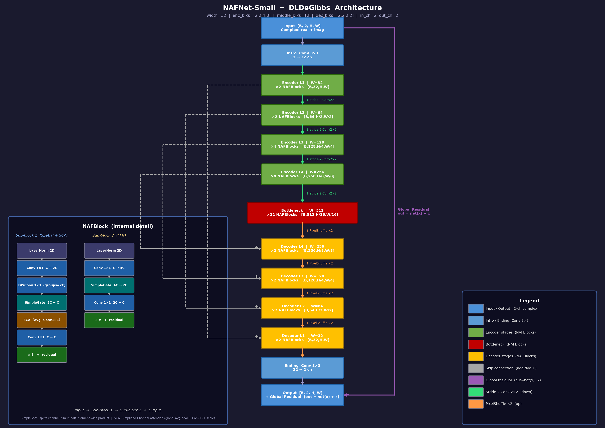

# XE129 DlDegibbs (NAFNet Adaptation)

[Original Paper](https://arxiv.org/abs/1905.04176) | [Original Repository](https://github.com/mmuckley/dldegibbs)

This repository contains an adaptation of the dldegibbs pipeline for XE129 MRI with a NAFNet-based restoration model.

The original dldegibbs work focused on Gibbs ringing and noise removal for diffusion MRI. In this implementation, the restoration backbone is based on NAFNet to improve robustness and reconstruction quality for the XE129 use case.

This package is intended for research use only and has not been validated for clinical use.

## NAFNet Architecture

The current implementation includes a NAFNet model definition and configuration workflow for training and inference.

- Main model implementation: nafnet.py
- Model configuration: nafnet_config.py and configs/nafnet.yaml
- Factory and integration: model_factory.py and degibbs_model.py
- Inference entry point: infer_xe129.py



## Usage

The primary training/evaluation entry point is degibbs_main.py. Configuration files are stored in configs/ and use YAML format.

Example:

```bash
python degibbs_main.py magnitude --exp_dir="my_exp_dir/"
```

Options passed at the command line override values in the YAML configuration files.

## Pretrained Models

If you are using pretrained checkpoints, set the experiment/checkpoint directory in configs/data.yaml to the local path where the model files are stored.

When running degibbs_main.py or infer_xe129.py, the script should report that it located and loaded the checkpoint.

## Citation

```latex
@article{muckley2019training,
  title={Training a Neural Network for Gibbs and Noise Removal in Diffusion MRI},
  author={Muckley, Matthew J and Ades-Aron, Benjamin and Papaioannou, Antonios and Lemberskiy, Gregory and Solomon, Eddy and Lui, Yvonne W and Sodickson, Daniel K and Fieremans, Els and Novikov, Dmitry S and Knoll, Florian},
  journal={arXiv preprint arXiv:1905.04176},
  year={2019}
}
```
